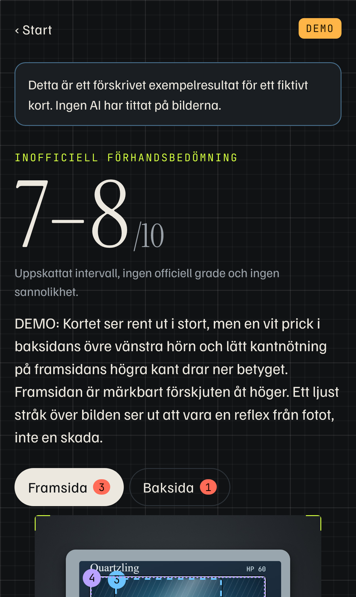
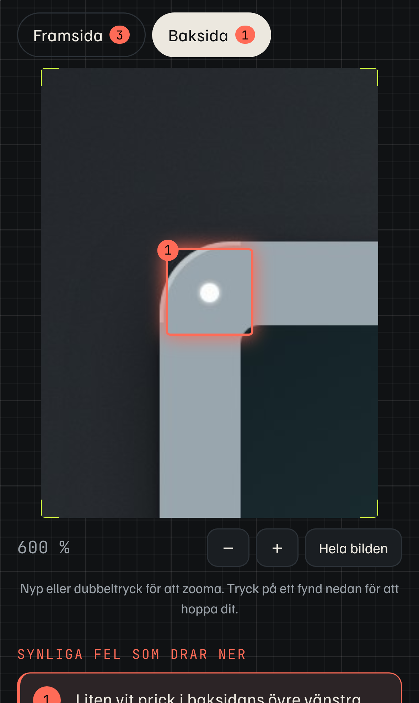
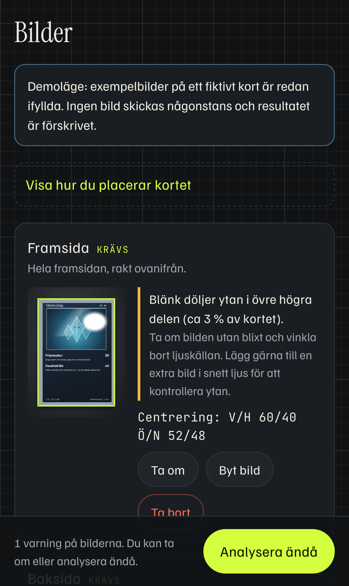

# PokeScanner

Fota ett Pokémonkort med mobilen och få en motiverad, inofficiell uppskattning av vilken grade det kan få, och exakt vad på kortet som drar ner den. Varje fynd pekar ut bild och plats, så att du kan zooma in och kontrollera själv.

Gratis, öppen källkod och utan konto. Du använder din egen API-nyckel, som bara finns i minnet medan sidan är öppen.

<p>
  
  
  
</p>

> Skärmbilderna visar demoläget med ett fiktivt kort som tillhör projektet. Ingen riktig kortbild finns i repot.

## Vad appen gör

Du fotar fram- och baksidan, och vid behov en närbild eller en bild i snett ljus. Innan något skickas kontrollerar appen bilderna lokalt i webbläsaren: blänk, skärpa, exponering, upplösning och om alla fyra hörn syns. Den säger vilken bild som bör tas om och varför. Samtidigt mäts centreringen direkt i bilden, och ett mått som 60/40 visas bara när mätningen gick att göra tillförlitligt.

När du trycker **Analysera** skickas bilderna till Claude, som bedömer centrering, hörn, kanter och yta. Resultatet är ett intervall på skalan 1–10 med de viktigaste fynden, var och en märkt som synligt fel, möjlig reflex eller del av kortets tryck, plus en lista över det som inte går att bedöma från bilderna. Om underlaget är för dåligt avstår appen från att ge en grade. Den visar aldrig påhittade sannolikheter, till exempel "70 % chans för PSA 10".

Appen försöker också läsa kortets namn, nummer, set och språk (japanska, engelska med flera). Uppgifterna går att rätta, och okända kort fungerar lika bra. Bedömningar sparas lokalt på enheten, och om du senare skickar in kortet kan du lägga in den faktiska graden och jämföra. Att öppna en sparad bedömning gör inga nya anrop.

## Prova direkt

Starta appen och tryck **Prova demo utan nyckel**. Demoläget fyller i bilder på ett fiktivt kort och visar ett förskrivet, tydligt märkt exempelresultat. Ingenting skickas någonstans.

## Snabbstart

Kräver Node 22.12 eller senare (för testerna rekommenderas Node 24.15 eller senare).

```bash
git clone https://github.com/LucasAi0808/pokescanner.git
cd pokescanner
npm install
npm run dev -- --host
```

Öppna adressen som Vite skriver ut under `Network`, till exempel `http://192.168.1.23:5173`, i Safari på iPhonen. Telefonen och datorn ska vara på samma wifi. På Windows frågar brandväggen första gången om Node får ta emot anslutningar. Svara ja för privata nätverk.

Kameran fungerar över vanlig http eftersom appen använder telefonens egen kamera via filväljaren, så du behöver inget certifikat. Vill du ha appen som en ikon på hemskärmen väljer du Dela och sedan Lägg till på hemskärmen i Safari.

## Din egen API-nyckel

PokeScanner använder Anthropics API (Claude) med bildstöd.

1. Skapa ett konto och en API-nyckel på [console.anthropic.com](https://console.anthropic.com). Nyckeln börjar med `sk-ant-`.
2. Tryck **Analysera** i appen. Innan första analysen visas vem som tar emot bilderna, vilken modell som används och en ungefärlig kostnad för just den analysen. Klistra in nyckeln där.
3. Nyckeln ligger bara i minnet i den öppna fliken. Den sparas inte i webbläsaren, skrivs inte till loggar eller resultat och följer inte med bygget. Laddar du om sidan behöver du klistra in den igen.

Kostnaden tas från ditt eget Anthropic-konto enligt deras prislista. En analys med två bilder kostar ungefär 1–3 kr med Claude Opus 5.5 (standard) och ungefär hälften med Claude Sonnet 5.5, som du kan välja i samma dialog. Efter analysen visas faktisk tokenåtgång och uppskattad kostnad.

Anropet går direkt från webbläsaren till `api.anthropic.com`, utan någon mellanserver. Bilderna skickas först när du trycker Analysera, och innan dess skalas de ner och kodas om, vilket också tar bort EXIF-data som GPS-position.

## Hur bedömningen fungerar

Bedömningen sker i två lager. Det första körs lokalt i webbläsaren och hittar kortets fyra kanter med en egen, enkel kantdetektion (linjeanpassning per sida), kontrollerar bildkvaliteten och mäter centreringen genom att leta upp ramens innerkant på varje sida. Det andra lagret är modellen, som får bilderna i en storlek som ryms inom Anthropics gränser (högst 2 576 px och 4 784 bildtokens). Då stämmer modellens pixelkoordinater exakt med bilden du ser, och fyndrutorna hamnar rätt när du zoomar.

Modellen svarar med strukturerad JSON enligt ett fast schema. Appen validerar svaret och rättar det som går att rätta, till exempel omkastade intervall eller rutor utanför bilden. Svar som inte går att tolka visas som ett begripligt fel i stället för ett halvt resultat. Modellen är instruerad att skilja på fel, reflexer och tryck, att avstå hellre än att gissa och att aldrig ange sannolikheter eller egna centreringstal.

## Vad foton kan missa

Ett foto är inte ett kort i handen. Mikrorepor, små tryckpunkter och ytdefekter syns ofta bara i lupp eller i rätt ljusvinkel, och böjning, tjocklek, återförslutna kanter eller om kortet är äkta går inte att bedöma från en bild. Blänk och plastfickor kan både dölja skador och skapa falska. Bedömningen är därför en förhandskoll som hjälper dig att välja vilka kort som är värda att skicka in, inte en ersättning för en riktig gradering.

## Projektstruktur

```
src/
  grading/      modellkopplingen: schema, prompt, leverantörer, fel
  quality/      lokal kvalitetskontroll, kortdetektion och centrering
  images/       nedskalning och omkodning av bilder
  storage/      lokal historik i IndexedDB
  screens/      appens vyer
  ui/           bildvisaren med zoom och fyndrutor
tests/
  unit/         Vitest: schema, normalisering, felmappning, bildanalys
  e2e/          Playwright i WebKit med iPhone-profil och simulerat API
  smoke/        röktest mot det riktiga API:t (kräver nyckel)
scripts/        demobilder, ikoner, skärmbilder och nyckelkontroll
```

### Lägga till en annan modell

Modellkopplingen är separat från resten av appen. En leverantör implementerar gränssnittet `GradingProvider` i [`src/grading/provider.ts`](src/grading/provider.ts) och registreras i [`src/grading/registry.ts`](src/grading/registry.ts). En lokal bildmodell, till exempel via Ollama på din egen dator, behöver bara ta emot bilderna och returnera samma JSON-schema som Claude (`ModelOutputSchema` i [`src/grading/types.ts`](src/grading/types.ts)). Demoläget i [`src/grading/demo.ts`](src/grading/demo.ts) är ett minimalt exempel på en leverantör.

## Tester

```bash
npm test            # enhetstester (Vitest)
npm run test:e2e    # hela flödet i WebKit med iPhone-profil och simulerat API
npm run build       # bygger och kontrollerar att ingen nyckel hamnat i dist/
```

Första gången e2e-testerna körs behöver Playwright ladda ner WebKit: `npx playwright install webkit`.

E2e-sviten fångar alla anrop till `api.anthropic.com` och svarar med simulerade svar. Den täcker uppladdning, kvalitetsvarningar, samtycke, svarsformat, lokal historik utan nya anrop, radering, ogiltig nyckel (401), avbruten analys, svar i fel format, överbelastat API (529), att modellen avböjer, att modellen avstår och att nyckeln aldrig hamnar i lagring eller loggar.

Röktestet kör samma kod mot det riktiga API:t med demobilderna och kostar ett anrop:

```bash
# PowerShell
$env:ANTHROPIC_API_KEY="sk-ant-..."; npm run smoke:real
# bash
ANTHROPIC_API_KEY=sk-ant-... npm run smoke:real
```

## Publicera med GitHub Pages

Repot innehåller ett workflow i [`.github/workflows/pages.yml`](.github/workflows/pages.yml) som bygger och publicerar appen när du pushar till `main`. Slå på det under Settings → Pages → Source: GitHub Actions. Sidan får då https och fungerar på mobilen utan att datorn är igång. Eftersom nyckeln matas in av den som använder sidan finns inga hemligheter i repot eller i bygget.

## Licens och varumärken

Koden är licensierad under [MIT](LICENSE). Typsnitten i `public/fonts/` (Familjen Grotesk, Instrument Serif och JetBrains Mono) är licensierade under SIL Open Font License 1.1, se [`public/fonts/LICENSE-FONTS.txt`](public/fonts/LICENSE-FONTS.txt). Demokortet "Quartzling" och alla bilder i repot är skapade för projektet.

PokeScanner är ett inofficiellt fan-projekt. Pokémon och alla relaterade namn är varumärken som tillhör Nintendo, Creatures, GAME FREAK och The Pokémon Company. Projektet har ingen koppling till dem eller till graderingsbolag som PSA, BGS eller CGC, och bedömningarna är inga officiella betyg.
