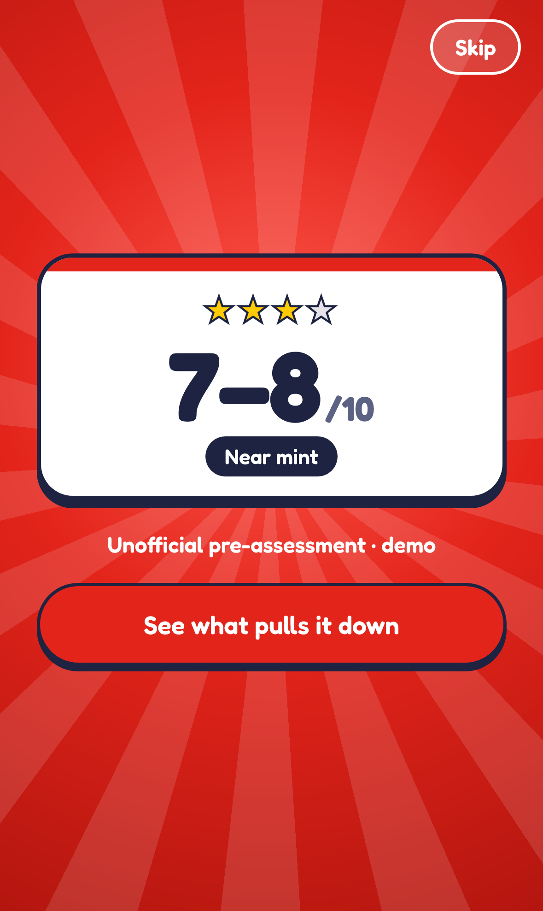
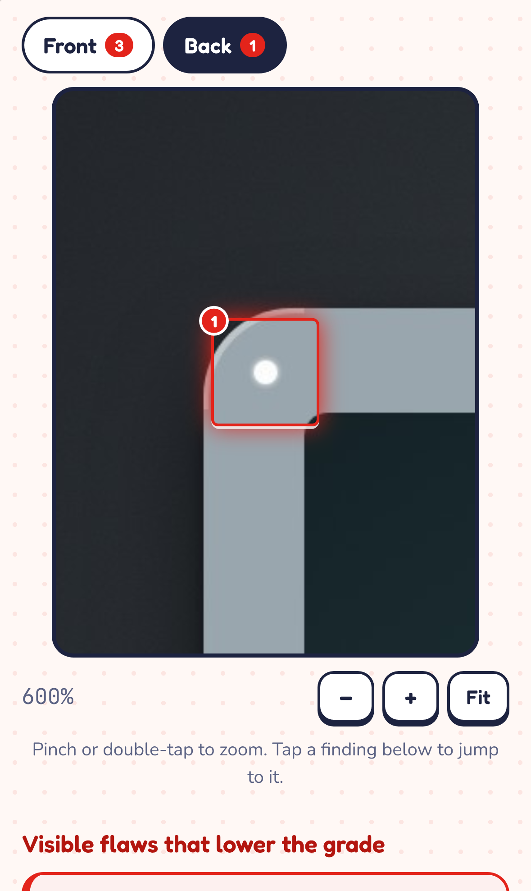
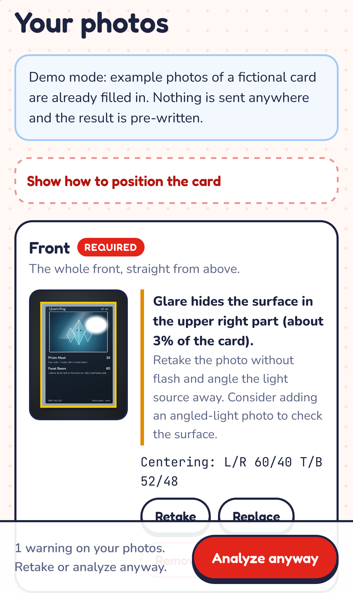

# PokeScanner

Snap your Pokémon card with your phone and get an explained, unofficial estimate of the grade it could get, plus exactly what on the card pulls it down. Every finding points to a photo and a spot, so you can zoom in and check it yourself.

Free, open source and no account. You bring your own API key, which only lives in memory while the page is open.

**Try it:** [lucasai0808.github.io/pokescanner](https://lucasai0808.github.io/pokescanner/). Open it in Safari on your iPhone and tap *Try the demo* if you do not have a key.

<p>
  
  
  
</p>

> The screenshots show demo mode with a fictional card made for this project. The repo contains no real card images.

## What it does

You snap the front and back, and if you want a close-up or a photo in angled light. Before anything is sent, the app checks the photos right in your browser for glare, focus, exposure, resolution and whether all four corners are visible, and tells you which photo to retake and why. It also measures centering directly in the image, and a value such as 60/40 is only shown when the measurement was reliable.

When you tap **Analyze**, the photos go to Claude, which assesses centering, corners, edges and surface. A fresh result opens like a booster pack: tear it open and the estimate comes out as a rarity card with one to four stars. Below it you get a range on the 1–10 scale with the most important findings, each one labelled as a visible flaw, a possible reflection or part of the card's print, plus a list of what cannot be judged from the photos. If the photos are too poor, the app declines to give a grade. It never shows made-up probabilities such as "70% chance of a PSA 10".

The app also tries to read the card's name, number, set and language (English, Japanese and more). You can correct the details, and unknown cards work just as well. Results are saved on your device, and if you send the card in later you can add the actual grade and compare. Opening a saved result makes no new requests.

## Try it right away

Open the app and tap **Try the demo**. Demo mode fills in photos of a fictional card and shows a pre-written, clearly labelled example result. Nothing is sent anywhere.

## Quick start

Requires Node 22.12 or later (Node 24.15 or later is recommended for the tests).

```bash
git clone https://github.com/LucasAi0808/pokescanner.git
cd pokescanner
npm install
npm run dev -- --host
```

Open the address Vite prints under `Network`, for example `http://192.168.1.23:5173`, in Safari on your iPhone. The phone and computer need to be on the same Wi-Fi. On Windows the firewall may ask whether Node can accept connections the first time; allow it for private networks.

The camera works over plain http because the app uses the phone's own camera through the file picker, so no certificate is needed. To get an icon on your home screen, choose Share and then Add to Home Screen in Safari.

## Your own API key

PokeScanner uses Anthropic's API (Claude) with image support.

1. Create an account and an API key at [console.anthropic.com](https://console.anthropic.com). The key starts with `sk-ant-`.
2. Tap **Analyze** in the app. Before the first analysis it shows who receives the photos, which model is used and a rough cost for that specific analysis. Paste your key there.
3. The key only lives in memory in the open tab. It is not stored in the browser, never written to logs or results and never part of the build. If you reload the page you paste it again.

The cost is charged to your own Anthropic account at their list price. An analysis with two photos costs roughly $0.10–0.30 with Claude Opus 5.5 (the default) and about half that with Claude Sonnet 5.5, which you can pick in the same dialog. After the analysis the app shows the actual token usage and the estimated cost.

The request goes straight from your browser to `api.anthropic.com`, with no server in between. Photos are only sent when you tap Analyze, and before that they are downscaled and re-encoded, which also strips EXIF data such as your GPS location.

## How the grading works

The assessment has two layers. The first runs locally in the browser: it finds the four edges of the card with a small edge detector of its own (a line fit per side), checks the photo quality and measures centering by finding the inner edge of the border on every side. The second layer is the model, which receives the photos at a size that fits Anthropic's limits (at most 2,576 px and 4,784 image tokens). That way the model's pixel coordinates match the image you see exactly, and the finding boxes land in the right place when you zoom.

The model replies with structured JSON that follows a fixed schema. The app validates the reply and fixes what can be fixed, such as a reversed range or boxes outside the image. Replies that cannot be read are shown as a clear error instead of a half result. The model is told to separate flaws, reflections and print features, to abstain rather than guess and never to give probabilities or its own centering numbers.

The stars are a playful summary of the range and nothing more: one star for 1–3, two for 4–6, three for 7–8 and four with holo foil for 9–10.

## What photos can miss

A photo is not a card in your hand. Micro scratches, tiny print dots and surface flaws often only show under a loupe or at the right angle, and bending, thickness, trimmed edges or whether the card is genuine cannot be judged from a photo. Glare and sleeves can both hide damage and create false flaws. Think of the result as a first check that helps you decide which cards are worth sending in, not as a replacement for a real grading.

## Project structure

```
src/
  grading/      model connection: schema, prompt, providers, errors
  quality/      local photo check, card detection and centering
  images/       downscaling and re-encoding of photos
  storage/      local history in IndexedDB
  screens/      the app's views
  ui/           zoomable viewer, booster pack, holo foil, energy icons
tests/
  unit/         Vitest: schema, normalization, error mapping, image analysis
  e2e/          Playwright in WebKit with an iPhone profile and a simulated API
  smoke/        smoke test against the real API (needs a key)
scripts/        demo images, icons, screenshots and the key check
```

### Adding another model

The model connection is separate from the rest of the app. A provider implements the `GradingProvider` interface in [`src/grading/provider.ts`](src/grading/provider.ts) and is registered in [`src/grading/registry.ts`](src/grading/registry.ts). A local vision model, for example through Ollama on your own computer, only needs to accept the photos and return the same JSON schema as Claude (`ModelOutputSchema` in [`src/grading/types.ts`](src/grading/types.ts)). Demo mode in [`src/grading/demo.ts`](src/grading/demo.ts) is a minimal example of a provider.

## Tests

```bash
npm test            # unit tests (Vitest)
npm run test:e2e    # the whole flow in WebKit with an iPhone profile and a simulated API
npm run build       # builds and checks that no key ended up in dist/
```

The first time you run the e2e tests, Playwright needs to download WebKit: `npx playwright install webkit`.

The e2e suite intercepts every request to `api.anthropic.com` and answers with simulated replies. It covers upload, photo warnings, consent, the booster reveal, the response format, local history without new requests, deleting, an invalid key (401), a cancelled analysis, a reply in the wrong format, an overloaded API (529), the model declining, the model abstaining, that the whole interface is in English and that the key never ends up in storage or logs.

The smoke test runs the same code against the real API with the demo photos and costs one request:

```bash
# bash
ANTHROPIC_API_KEY=sk-ant-... npm run smoke:real
# PowerShell
$env:ANTHROPIC_API_KEY="sk-ant-..."; npm run smoke:real
```

## Publishing with GitHub Pages

The workflow in [`.github/workflows/pages.yml`](.github/workflows/pages.yml) runs the tests, builds the app and publishes it on every push to `main`. Turn it on under Settings → Pages → Source: GitHub Actions. Since the key is entered by whoever uses the page, there are no secrets in the repo or the build.

## License and trademarks

The code is licensed under [MIT](LICENSE). The fonts in `public/fonts/` (Fredoka, Nunito and JetBrains Mono) are licensed under the SIL Open Font License 1.1, see [`public/fonts/LICENSE-FONTS.txt`](public/fonts/LICENSE-FONTS.txt). The demo card "Quartzling", the logo, the energy icons and all images in the repo were made for this project.

PokeScanner is an unofficial fan project. Pokémon and all related names are trademarks of Nintendo, Creatures, GAME FREAK and The Pokémon Company. The project is not affiliated with them or with grading companies such as PSA, BGS or CGC, and its assessments are not official grades.
